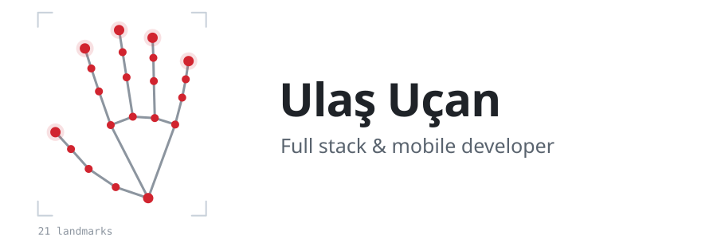

<picture>
  <source media="(prefers-color-scheme: dark)" srcset="assets/header-dark.svg">
  
</picture>

I'm Ulaş, a full stack and mobile developer based in Istanbul, studied Computer Engineering at İzmir Bakırçay University (2022–2026). I build apps and take them all the way to the store: native Android with Kotlin and Jetpack Compose, cross-platform with React Native, and the web and backend parts around them. My sign language app, Conversign, runs a PyTorch-trained model directly on the phone, with no server round trip.

## Selected work

### [Conversign](https://github.com/UlasUcan77/Conversign) — real-time sign language recognition
**3rd place worldwide, Huawei ICT Competition · Teknofest 2025 finalist**

An Android app that turns sign language gestures from the live camera feed into text. MediaPipe extracts 21 hand landmarks per frame, and a classifier trained in PyTorch, exported to ONNX, runs on the device with ONNX Runtime. I rewrote it from Flutter to native Kotlin and Jetpack Compose to fix compatibility issues on Huawei devices, using Clean Architecture with MVVM.

Published on Huawei AppGallery.

### [Anlat](https://github.com/UlasUcan77/Anlat) — real-time messaging between psychologists and clients
A React Native app, live on Google Play and the App Store. Chat runs over Socket.IO against a Node.js and PostgreSQL backend that runs in Docker on Railway, deployed through a CI/CD pipeline.

[Google Play](https://play.google.com/store/apps/details?id=com.anlatmamlazim.therapy)

### [Online Psikolog](https://github.com/UlasUcan77/OnlinePsikolog) — booking platform for psychologists
A React front end with a PHP backend: appointment booking, specialist listings, blog management and a responsive UI. I also handle deployment and server operations on cPanel.

[onlinepsikolog.org](https://www.onlinepsikolog.org/)

**Also:** Piyanko — a React Native mobile app and React admin panel on Firebase (Auth, real-time database, Cloud Functions) for a clinic management system; I also ran its Google Play release process.

## Stack

Kotlin · Jetpack Compose · React Native · Flutter · React · JavaScript · PHP · Python · PyTorch · Firebase · Docker · SQL · Git

## Contact

[Portfolio](https://claude.ai/artifact/F88g3RjiCXqDh8wEp9KqBb) · [LinkedIn](https://www.linkedin.com/in/ula%C5%9F-u%C3%A7an-36531626b) · [uls.ucn@gmail.com](mailto:uls.ucn@gmail.com)
